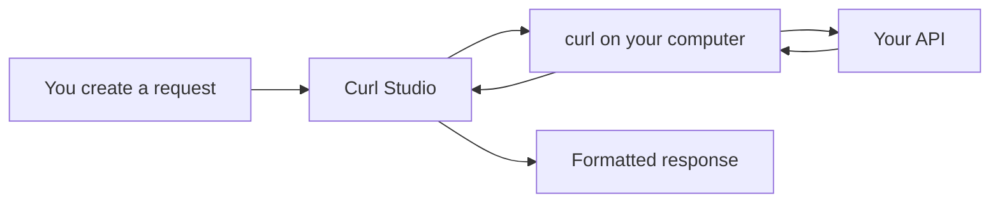
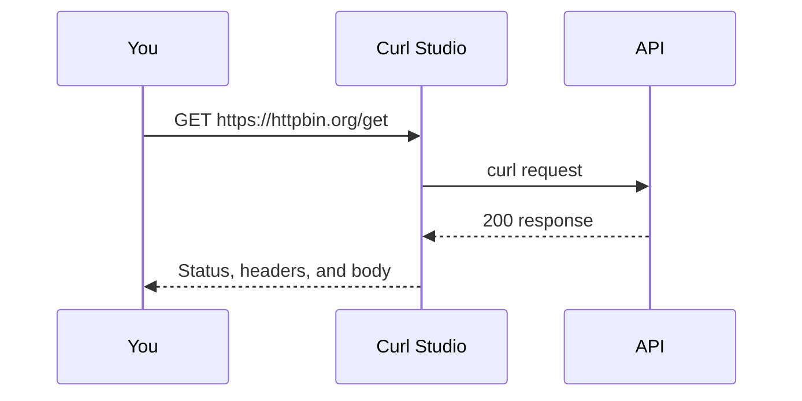

# Curl Studio

Curl Studio is a friendly, local app for calling and testing APIs. Build a request with a form, edit its JSON directly, or run a curl command. Your requests run on your own computer—there is no cloud account or relay.



## Start here

Choose the instructions for your computer. The downloadable app builds are included in this repository.

| Computer | File to open | What to do |
| --- | --- | --- |
| Windows 10/11 | `Curl-Studio-Setup-Windows-x64.exe` | Double-click it, approve Windows' warning if you trust the file, then open Curl Studio. |
| macOS, Apple Silicon | `Curl-Studio-Mac-Apple-Silicon.pkg` | Open the package and follow the installer. |
| macOS, Intel | `Curl-Studio-Mac-Intel.pkg` | Open the package and follow the installer. |
| Ubuntu/Debian Linux | `Curl-Studio-Linux-amd64.deb` | Run the command below. |

On Ubuntu or Debian, open Terminal in this folder and run:

```bash
sudo apt install ./Curl-Studio-Linux-amd64.deb
```

The desktop builds are unsigned. Your operating system may show a safety prompt; install only a copy you trust. Curl Studio needs `curl`, which is already available on current Windows and macOS systems and most Linux distributions.

## First request in three steps

1. Open Curl Studio and select **GET**.
2. Paste an API address, for example `https://httpbin.org/get`.
3. Click **Send request**. The response panel shows the status code, headers, timing, and body.



## Send JSON data

For an API that accepts JSON, choose **POST**, add the `Content-Type: application/json` header, then use the **JSON editor** tab.

```json
{
  "name": "Ada",
  "email": "ada@example.com",
  "newsletter": true
}
```

Equivalent curl command:

```bash
curl -X POST "https://httpbin.org/post" \
  -H "Content-Type: application/json" \
  -d '{"name":"Ada","email":"ada@example.com","newsletter":true}'
```

On Windows Command Prompt, use `curl.exe` and put the command on one line:

```cmd
curl.exe -X POST "https://httpbin.org/post" -H "Content-Type: application/json" -d "{\"name\":\"Ada\"}"
```

Curl Studio creates a matching curl command for every request. Copy it from **Generated curl** when you need a terminal command.

## Use the source code

Install [Node.js 22 or later](https://nodejs.org/), then open a terminal in the project folder.

```bash
npm install
npm start
```

Open <http://127.0.0.1:3210> in your browser. Stop the server with `Ctrl+C`.

Windows alternative:

```cmd
Start-Windows.cmd
```

macOS/Linux alternative:

```bash
bash Start-Unix.sh
```

To run the native Electron desktop app from source:

```bash
npm run desktop
```

## Features

- **UI builder:** add headers and create nested JSON objects and arrays without hand-writing JSON.
- **JSON editor:** paste, format, validate, and send a complete JSON document.
- **Generated curl:** view and copy an equivalent command for Bash, PowerShell, or CMD.
- **Console:** run a trusted curl command from the app. Commands have your account permissions, so never run a command you do not understand.
- **Response view:** see the HTTP status, elapsed time, response headers, formatted JSON, and raw text.

## Helpful commands

Run automated checks:

```bash
npm test
```

Create desktop packages (requires internet to download Electron build components):

```bash
npm run dist -- --linux deb --x64
npm run dist -- --win portable --x64
npm run dist -- --mac zip --arm64 --x64
```

## Safety and privacy

Curl Studio binds its local server only to `127.0.0.1`. API requests use installed `curl`, avoiding browser CORS restrictions. It does not send requests to a Curl Studio cloud service. Do not expose the local server with a proxy or tunnel, and use the Console only with commands you trust.

## Troubleshooting

| Problem | Try this |
| --- | --- |
| `npm` is not recognized | Install Node.js, close and reopen your terminal, then run `node --version`. |
| Port 3210 is already in use | Close the other Curl Studio/Node process, then run `npm start` again. |
| A request fails | Check the URL, method, required headers, and API authentication. The response panel contains the server error when one is returned. |
| Linux app will not install | Confirm you use Debian/Ubuntu on 64-bit Intel/AMD (`amd64`) and run the `apt install` command above. |

## Development notes

`npm test` starts a local API and verifies nested JSON posts, headers, HTTP failures, shell pipes, invalid protocols, and session authorization. It does not call a production API.

License: [MIT](LICENSE).
